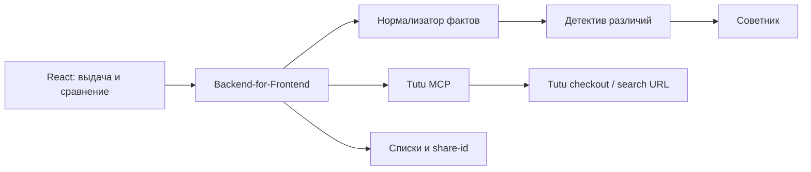

# Туту Сравни

> Не просто сохраняйте варианты — принимайте решение.

## 1. Проблема

Избранное отвечает на вопрос «что мне понравилось», но не отвечает на вопрос
«что из этого лучше именно для моей поездки». Пользователь открывает несколько
вкладок, вручную сопоставляет багаж, отмену, время, вокзалы, рейтинг и цену,
а затем всё равно боится упустить важное различие.

Идея проекта — добавить в Туту **живые списки сравнения**. В список можно
положить несколько рейсов, поездов, автобусов или отелей. Сервис сам выделяет
различия, проверяет важные ограничения пользователя и объясняет компромисс.

Главная формула продукта:

**Избранное хранит желание → Сравнение помогает принять решение → Туту ведёт к покупке.**

## 2. Как выглядит продукт

### На выдаче

У каждой карточки рядом с сердцем появляется кнопка «Сравнить». После добавления
двух вариантов снизу открывается компактная панель:

`Сравниваем 3 варианта · Показать различия`

### На странице сравнения

Варианты стоят колонками. Строки — параметры. По умолчанию включён режим
«Только различия», поэтому пользователь не читает одинаковые факты.

Над таблицей — приоритеты:

- дешевле;
- быстрее;
- без пересадок;
- с возвратом;
- с багажом;
- спокойнее;
- свой текст: «едем вдвоём, нужен багаж и не хотим вставать раньше 7 утра».

Справа работает агент «Разбор выбора». Он не придумывает факты, а объясняет
решение только через поля текущего ответа MCP:

> Автобус дешевле, но занимает на 5 часов больше. Самолёт быстрее, однако
> выбранный тариф без багажа и невозвратный. Поезд дороже автобуса, зато без
> пересадок, приходит в центр и для него найдены два места в одном блоке.

### Список поездки

Плоская таблица плохо подходит для сравнения отеля и билета. Поэтому список
имеет секции:

1. «Как добраться» — авиа, поезд, автобус, электричка.
2. «Где жить» — отели и конкретные номера/тарифы.
3. «Финальные сборки» — выбранный транспорт + выбранный отель, общий бюджет.

Так пользователь сравнивает однородные варианты честно, а затем видит стоимость
всей поездки.

## 3. Что реально даёт Tutu MCP

Проверен сервер `https://mcp.tutu.ru/mcp`, версия 0.38.0, Streamable HTTP.
Сервер read-only: он ищет предложения и строит ссылки, но не хранит аккаунты,
не бронирует и не принимает оплату.

### Поиск

| Инструмент              | Что используем в сравнении                                                                                                                                             |
| ----------------------- | ---------------------------------------------------------------------------------------------------------------------------------------------------------------------- |
| `search_multitransport` | Единая выдача авиа, поездов, автобусов и электричек; сортировка по цене/времени; мягкий отказ одного режима без падения всего ответа. Идеальная основа первого экрана. |
| `search_avia`           | Цена, время, перевозчик, аэропорты, номера рейсов, пересадки, тарифы, багаж/ручная кладь, возврат и обмен, multi-PNR/self-transfer, рейтинг.                           |
| `search_rail`           | Цена, длительность, конкретные вокзалы, номер/бренд поезда, классы вагонов, число тарифов, возврат/обмен, доступность мест, рейтинг.                                   |
| `search_bus`            | Цена всей группы, остановки, перевозчик, длительность, рейтинг; детальные свойства загружаются после добавления в список.                                              |
| `search_etrain`         | Расписание, цена, станции, тип состава, длительность. Checkout ведёт на расписание, а не на точный оффер.                                                              |
| `search_hotels`         | Итоговая цена за всё проживание, рейтинг, звёзды, адрес, фото, дешёвый доступный номер, завтрак, отмена, оплата, удобства.                                             |

Все поиски поддерживают пагинацию. Транспорт можно фильтровать по цене,
прямому маршруту и перевозчику; авиа — ещё по номеру рейса и классу, поезда —
по номеру и категории вагона; отели — по рейтингу, звёздам, питанию, отмене,
типу и удобствам.

`search_multitransport` считает только взрослых. Для семьи с детьми надо
параллельно вызывать конкретные `search_avia` и `search_bus`, чтобы цена
соответствовала реальному составу группы.

### Обогащение выбранных карточек

`get_offer_details` нельзя вызывать для всей выдачи — это медленно и шумно.
Его надо вызывать параллельно только для 2–4 вариантов в списке.

- Авиа: презентационная нормализация выбранного оффера; отдельного live-detail
  endpoint нет, поэтому факты берём из тарифов поиска.
- Поезд: классы, описания, удобства, фото, возвратные/невозвратные тарифы,
  вагоны и число мест.
- Автобус: точные адреса остановок, кондиционер/Wi-Fi/розетки/туалет,
  электронный билет, багаж, правила возврата, свободные места.
- Электричка: нормализованная карточка и сведения об электронном билете.
- Отель: конкретные комнаты, кровать, вид, площадь, удобства, варианты питания,
  бесплатная отмена, срок отмены, способ оплаты, отзывы и оценки по аспектам.

Для отелей есть четыре уровня: `compact`, `rules`, `reviews`, `full`. Поэтому
сравнение можно загружать прогрессивно: сначала основные факты, затем правила
отмены или отзывы только по запросу.

### Места в поезде

`get_rail_seatmap` — один из главных wow-элементов демо. Он умеет:

- найти N мест вместе (`task=together`);
- подобрать места дальше от туалета (`far_from_wc`);
- найти женские места (`female`);
- дать сводку по свободным местам (`summary`);
- отдать полную схему выбранного вагона.

После подтверждения мест `create_checkout_link` может открыть корзину с этими
местами. Цены seatmap используются только для сравнения мест: точную сумму к
оплате надо показывать из `search_rail`, потому что в корзине сервисный сбор
выше.

### Переход к покупке

`create_checkout_link` строит ссылку для любого продукта:

- авиа — ссылка на выбранный перелёт после окончательного выбора; во время
  сравнения показываем только `search_results_url`;
- поезд и автобус — страница мест или корзина с подтверждёнными местами;
- отель — страница выбора номера или корзина с выбранным тарифом комнаты;
- электричка — страница расписания.

Checkout URL и search URL считаются непрозрачными строками: их нельзя
пересобирать или менять на клиенте.

### Остальной функционал MCP

- `plan_trip` — готовый prompt для поездки в рамках общего бюджета: транспорт
  плюс отель.
- `tutu://amenities/dictionary` — стабильные коды удобств для поездов,
  автобусов и электричек.
- `tutu://geo` — справочник городов и точек.
- `tutu://status` — состояние сервера и upstream-сервисов.
- `tutu://version` — версия и fingerprint схем.
- `tutu://special-offers` — только демо-вдохновение, не live-лента цен.
- Шесть `get_*_instructions` — правила корректной работы по доменам.

## 4. Главная фишка: агент сравнения

Это не один «магический» LLM. Конвейер из четырёх узких агентов проще
проверить и эффектнее показать на презентации.

### 1. Разведчик

Получает компактную выдачу через `search_multitransport` или доменный поиск.
Отображает варианты сразу, даже если один источник временно недоступен.

### 2. Нормализатор

Приводит разные продукты к общей модели:

- цена всей группы;
- отправление/прибытие;
- длительность;
- пересадки;
- точка отправления/прибытия;
- рейтинг и число отзывов;
- возвратность;
- статус каждого факта: `да / нет / неизвестно`.

Значение `неизвестно` критично. Если MCP не вернул багаж, вид из окна или
условия обмена, интерфейс пишет «Туту не вернул это поле», а не делает вывод.

### 3. Детектив различий

Загружает `get_offer_details` только для добавленных карточек и скрывает
одинаковые строки. Он выделяет не максимальное число характеристик, а те,
которые реально меняют решение.

### 4. Советник

Применяет сначала жёсткие ограничения, затем веса предпочтений. Например:

1. Исключить варианты без подтверждённого багажа.
2. Исключить отправления раньше 07:00.
3. Среди оставшихся оценить цену 50%, время 30%, комфорт 20%.

На выходе — не абстрактный «score 87», а объяснение:

- почему вариант победил;
- в чём его главный минус;
- сколько стоит переход к следующему лучшему варианту;
- какие факты остались неизвестны.

LLM можно использовать только для перевода структурированных фактов в
естественный язык. Фильтрация, вычисления и победитель должны быть
детерминированными — так результат быстрее, стабильнее и не галлюцинирует.

## 5. Модель данных

```ts
type CompareList = {
  id: string;
  title: string;
  trip: {
    origin: string;
    destination: string;
    departureDate: string;
    returnDate?: string;
    party: { adults: number; childrenAges: number[] };
  };
  sections: CompareSection[];
  preferences: Preference[];
  updatedAt: string;
};

type CompareItem = {
  domain: 'avia' | 'rail' | 'bus' | 'etrain' | 'hotels';
  offerId: string;
  snapshot: Record<string, unknown>;
  detailsRef?: Record<string, unknown>;
  checkoutRef?: Record<string, unknown>;
  facts: Record<
    string,
    {
      value: unknown;
      state: 'known' | 'unknown' | 'not_applicable';
      source: 'search' | 'details' | 'seatmap';
    }
  >;
  checkedAt: string;
};
```

`details_ref`, `checkout_ref` и opaque URLs передаются без изменений. Офферы
могут устаревать, поэтому сохранённая карточка — snapshot, а перед покупкой
нужно повторно проверить доступность.

## 6. Архитектура MVP



MCP не хранит избранное и аккаунты, поэтому списки — ответственность нашего
приложения. Для хакатона достаточно SQLite/Postgres; для полностью локального
демо — `localStorage` плюс share-id в небольшом backend.

Предлагаемые endpoints:

- `POST /api/search` — компактная выдача;
- `POST /api/lists` — создать список;
- `POST /api/lists/:id/items` — добавить карточку;
- `POST /api/lists/:id/enrich` — параллельно обогатить shortlist;
- `POST /api/lists/:id/refresh` — перепроверить сохранённые варианты;
- `POST /api/lists/:id/verdict` — пересчитать решение по предпочтениям;
- `POST /api/checkout` — получить ссылку только после выбора;
- `GET /s/:shareId` — публичный read-only список.

## 7. Как сделать быстро и стабильно

1. Использовать `view=compact` для первого экрана.
2. Запрашивать details только для shortlist, максимум 4 карточки параллельно.
3. Кэшировать одинаковые поиски на 2–5 минут и дедуплицировать запросы.
4. Показывать частичный результат, если один транспорт попал в
   `meta.unavailable`.
5. Не ходить по страницам вслепую: использовать точные фильтры по номеру
   рейса/поезда и `meta.has_more`.
6. Перед checkout обновлять выбранный вариант.
7. Никогда не пересчитывать цену отеля по числу ночей: MCP уже возвращает
   total за всё проживание.
8. Для семьи выполнять доменные поиски с реальным составом пассажиров.
9. Не смешивать цену seatmap с итоговой ценой поезда.
10. Логировать tool, latency, cache hit, unavailable mode и долю неизвестных
    полей — без персональных данных.

## 8. Реалистичный MVP и wow-функции

### Обязательный MVP

- кнопка «Сравнить» в карточках;
- список из 2–4 вариантов;
- общая таблица и режим «Только различия»;
- доменные параметры для авиа/поезда/автобуса/отеля;
- настройка приоритетов;
- объяснимый вердикт;
- обновление данных и переход на Туту.

### Wow для презентации

1. **Сравнение разных видов транспорта.** Один маршрут, автобус, самолёт и
   поезд в одной понятной матрице.
2. **«Что мы пожалеем?»** Агент одной строкой называет скрытый компромисс:
   нет багажа, ночное прибытие, другой аэропорт/вокзал, неизвестный возврат.
3. **Места рядом.** Для выбранного поезда агент находит два места в одном
   блоке и передаёт их в checkout.
4. **Смысл отзывов отеля.** Вместо общей оценки показывает аспекты
   «чистота / расположение / питание» и короткие реальные цитаты с датами.
5. **Сборки поездки.** Сравнить «дешёвый автобус + отель получше» против
   «быстрый поезд + отель подешевле» в рамках общего бюджета.
6. **Групповое решение.** Ссылка другу, простые голоса и поиск варианта,
   который не нарушает ничьих обязательных условий.

Для хакатона лучше реализовать первые четыре; сборки и голосование можно
показать как следующий шаг, если времени мало.

## 9. Сценарий презентации на 2–3 минуты

1. На выдаче Москва → Санкт-Петербург добавляем автобус, самолёт и поезд.
2. Открываем «Только различия»: цена, время, станции/аэропорты, багаж,
   возврат и рейтинг видны без новых вкладок.
3. Говорим: «Нас двое, нужен багаж, не хотим приезжать ночью».
4. Советник исключает неподходящий авиатариф и объясняет, почему поезд —
   лучший компромисс, а автобус — вариант экономии.
5. Нажимаем «Найдите места рядом» и показываем реальные места из seatmap.
6. Добавляем два отеля, сравниваем конкретные комнаты, отмену, завтрак и
   аспекты отзывов.
7. Сервис показывает итоговую сборку поездки и ведёт по настоящей ссылке
   Туту к выбору/покупке.

Финальная фраза:

> Сегодня Туту помогает найти варианты. «Туту Сравни» помогает уверенно
> выбрать один — и превращает сохранённый интерес в покупку.

## 10. Что честно не обещаем

- MCP не хранит избранное, списки и пользователей — это наш слой.
- Нет истории цен, поэтому «цена снизилась» нельзя утверждать без своей
  периодической базы наблюдений.
- Нет оплаты и бронирования через MCP; покупка завершается на Туту.
- Нельзя обещать сведения, которых нет в payload: время до аэропорта,
  положение автобусного кресла у окна, розетку у конкретного места и т. п.
- Сохранённый offer не вечен. Перед checkout его надо обновить или вернуть
  пользователя на актуальную выдачу.

Эти ограничения не ослабляют проект: наоборот, они показывают зрелую работу
с данными и делают демонстрацию правдоподобной.
