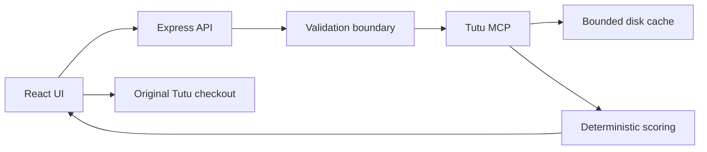

# Туту Сравнение

Веб-приложение для осознанного выбора поездки: оно получает реальные предложения транспорта и отелей из Tutu MCP, сопоставляет варианты по единым правилам и объясняет компромиссы без выдуманных данных.

## Что умеет продукт

- сравнивает самолёты, поезда, автобусы и электрички в одной выдаче;
- сравнивает любое количество отелей, показывая по четыре карточки с пошаговой прокруткой;
- учитывает цену, время, пересадки, ночные часы, багаж, рейтинг и надёжность данных;
- для отелей учитывает итоговую цену, цену за ночь, отзывы, расстояние, питание и гибкость бронирования;
- применяет фильтры сразу, сохраняет частичный результат при недоступности отдельного источника;
- ведёт пользователя на оригинальный checkout Туту, не имитируя бронирование;
- явно помечает кэшированный результат и никогда не подменяет неизвестные поля предположениями.

## Быстрый старт

Требования: Node.js 22+, pnpm 10+.

```bash
pnpm install --frozen-lockfile
pnpm dev
```

Интерфейс откроется на `http://127.0.0.1:5173`, API — на `http://127.0.0.1:8787`.

Проверка перед отправкой:

```bash
pnpm quality
```

Команда последовательно запускает ESLint, строгую проверку TypeScript, 20 детерминированных тестов, production-сборку клиента и сервера и проверку форматирования.

## Архитектура



- `src/features/hotels/` — самостоятельный UI-модуль выдачи и сравнения отелей;
- `src/scoring.ts` и `src/hotelScoring.ts` — чистые детерминированные правила;
- `server/validation.ts` — единая граница доверия для входных данных;
- `server/mcp.ts` — ограниченный по времени и размеру клиент Tutu MCP;
- `server/cache.ts` — атомарный файловый кэш с TTL и пределом количества записей;
- `server/http.ts` — security headers, rate limiting и стабильный публичный контракт ошибок;
- `server/main.ts` — production lifecycle и graceful shutdown.

Подробности: [архитектура](docs/ARCHITECTURE.md), [безопасность](docs/SECURITY.md), [развёртывание](docs/DEPLOYMENT.md), [контроль качества](docs/QUALITY.md), [формулы сравнения](SCORING_RULES.md).

## Команды

| Команда        | Назначение                                 |
| -------------- | ------------------------------------------ |
| `pnpm dev`     | API и Vite с hot reload                    |
| `pnpm lint`    | ESLint без предупреждений                  |
| `pnpm check`   | строгая проверка TypeScript                |
| `pnpm test`    | unit и API integration tests               |
| `pnpm build`   | клиент в `dist/`, сервер в `.server-dist/` |
| `pnpm start`   | запуск собранного production-сервера       |
| `pnpm quality` | полный локальный quality gate              |

## Конфигурация

Приложению не нужны ключи доступа. Поддерживаемые переменные перечислены в [.env.example](.env.example): адрес и таймаут MCP, host, port и версия сборки. Значения из `.env` не попадают в Git.

## Принципы целостности данных

1. Карточки, цены, фотографии, отзывы и checkout-ссылки поступают только из Tutu MCP.
2. Неизвестное значение остаётся неизвестным и снижает уверенность оценки.
3. Кэш используется только после реального успешного ответа и отражается в `meta.is_cached`.
4. Частичный отказ одного транспорта не скрывает результаты остальных источников.
5. Рекомендация воспроизводима: одинаковые входные данные и версия правил дают одинаковый результат.
