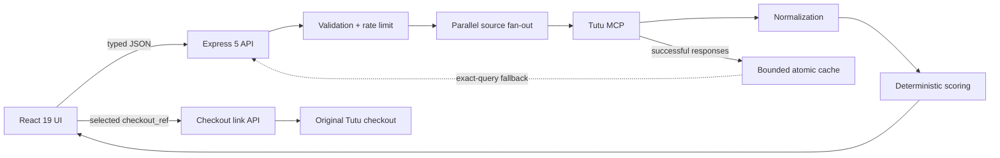

## 🥉 Итог хакатона Tutu 2026

Команда **R² negative** заняла **3-е место** на ИИ-хакатоне Tutu 2026 с проектом «Сравнение офферов». Сервис помогает сравнивать варианты поездок и отелей на реальных данных Tutu MCP.

| Команда | Результат | Проект |
|---|---|---|
| **R² negative** | **3-е место** | Сравнение предложений и осознанный выбор поездки |

Это личная копия проекта участника команды Игоря Борисова. [Исходный командный репозиторий](https://github.com/R2NN/compering).

<p align="center"></p>

---

# Туту Сравнение

<p align="center">
  <strong>Сервис осознанного выбора транспорта и отелей на реальных данных Tutu MCP</strong><br />
  Не просто сортирует по цене, а показывает различия, объясняет компромиссы и ведёт к оригинальному предложению Туту.
</p>

<p align="center">
  <a href="docs/USER_GUIDE.md"><strong>Руководство пользователя</strong></a>
  ·
  <a href="docs/ARCHITECTURE.md">Архитектура</a>
  ·
  <a href="SCORING_RULES.md">Правила сравнения</a>
</p>

<p align="center">
  <a href="https://github.com/R2NN/compering/actions/workflows/ci.yml"></a>
  
  
  
  
</p>


## Содержание

- [Продуктовая идея](#продуктовая-идея)
- [Почему выбрана именно эта задача](#почему-выбрана-именно-эта-задача)
- [Почему правила, а не LLM](#почему-правила-а-не-llm)
- [Возможности](#возможности)
- [Как работает рекомендация](#как-работает-рекомендация)
- [Архитектура](#архитектура)
- [Надёжность и безопасность](#надёжность-и-безопасность)
- [Запуск проекта](#запуск-проекта)
- [Тестирование и quality gate](#тестирование-и-quality-gate)
- [Production-развёртывание](#production-развёртывание)
- [Документация](#документация)

## Продуктовая идея

Пользователь редко выбирает поездку только по одному числу. Самый дешёвый билет может прибывать ночью, требовать пересадку и не включать багаж. Отель с высокой оценкой может иметь мало отзывов, находиться далеко от центра или предлагать негибкий тариф.

Обычная сортировка заставляет держать эти различия в голове и переключаться между карточками. **Туту Сравнение** превращает выдачу в понятный процесс принятия решения:

1. получает актуальные предложения от Tutu MCP;
2. нормализует факты разных типов транспорта или отелей;
3. оценивает их по выбранному приоритету;
4. показывает shortlist и сравнительную таблицу;
5. объясняет сильные стороны и главный компромисс;
6. открывает оригинальный checkout Туту.

Приложение не пытается заменить поиск или бронирование Туту. Оно закрывает отдельную ценную стадию между ними — **сравнение и уверенный выбор**.

## Почему выбрана именно эта задача

### Высокая пользовательская ценность

- Выбор поездки происходит регулярно и связан с реальными затратами денег и времени.
- Ошибка выбора проявляется не только в цене: пересадки, ночные часы, багаж и условия отмены влияют на всю поездку.
- Пользователю трудно сравнивать разные классы предложений по единой системе координат.
- Результат улучшения легко проверить: меньше ручных переключений, все существенные различия находятся на одном экране.

### Хорошее соответствие экосистеме Туту

Tutu MCP уже предоставляет структурированные предложения, цены, расписание, тарифные условия, отзывы и checkout reference. Поэтому продукт усиливает существующий путь пользователя и сохраняет единый источник истины вместо создания параллельного каталога.

### Правильный масштаб решения

Мы осознанно не выбрали:

| Альтернатива                        | Почему не она                                                                             |
| ----------------------------------- | ----------------------------------------------------------------------------------------- |
| Ещё один поисковик билетов          | Дублировал бы сильную часть существующего продукта, не решая проблему выбора              |
| Собственный booking flow            | Создавал бы риск расхождения цены и наличия; бронирование должно оставаться на Туту       |
| Скрейпинг сайтов                    | Хрупок, юридически и технически рискован, уступает официальному MCP-контракту             |
| Универсальный AI-чат о путешествиях | Даёт широкий, но плохо измеримый результат и может придумывать отсутствующие условия      |
| Генератор маршрутов                 | Требует большого числа субъективных предположений; текущая задача имеет проверяемые факты |

В результате решение остаётся сфокусированным: оно не размывает продукт, но глубоко прорабатывает критический этап выбора.

## Почему правила, а не LLM

В этой задаче входные данные уже структурированы, а критерии сравнения известны заранее. Нужно не генерировать новый смысл, а корректно посчитать цену, длительность, пересадки, надёжность отзывов и подтверждённые условия тарифа.

Детерминированная модель здесь лучше LLM по ключевым production-свойствам:

| Свойство             | Детерминированные правила                                 | LLM в критическом пути                                  |
| -------------------- | --------------------------------------------------------- | ------------------------------------------------------- |
| Воспроизводимость    | Одинаковый вход и версия правил дают одинаковый результат | Ответ может меняться между запросами                    |
| Проверяемость        | Каждая компонента покрывается unit-тестом                 | Нужны eval-наборы и вероятностные допуски               |
| Объяснимость         | Баллы напрямую связаны с фактами карточки                 | Объяснение может не совпасть с реальной причиной выбора |
| Работа с неизвестным | Поле исключается из расчёта и снижает confidence          | Есть риск правдоподобно дополнить отсутствующий факт    |
| Скорость             | Локальный расчёт без сетевого inference                   | Дополнительный сетевой вызов и генерация токенов        |
| Стоимость            | Нет переменной стоимости на рекомендацию                  | Стоимость растёт с каждым поиском и объёмом контекста   |
| Отказоустойчивость   | Работает при доступности данных MCP                       | Появляется ещё один внешний источник отказа             |

### Почему это особенно важно для Туту

Рекомендация влияет на покупку. Пользователь должен понимать, почему вариант победил, а команда — воспроизвести любой результат по входному ответу и версии правил. Недетерминированное ранжирование усложнило бы поддержку, разбор жалоб, A/B-тестирование и контроль качества.

LLM здесь была бы избыточной и дорогой не потому, что технология не полезна вообще, а потому что **она не должна заменять точный вычислимый алгоритм**. В будущем LLM можно безопасно использовать вне критического контура: например, для диалогового уточнения предпочтений или переформулировки уже рассчитанного объяснения. Итоговый score и факты при этом должны оставаться детерминированными.

## Возможности

### Транспорт

- единая выдача самолётов, поездов, автобусов и электричек;
- параллельный запрос независимых источников;
- приоритеты «Баланс», «Дешевле», «Быстрее», «Спокойнее»;
- цена, длительность, пересадки, ночные часы, точки отправления и прибытия;
- ручная кладь, багаж и стоимость тарифа с багажом для авиабилетов;
- возвратность, категории мест и рейтинг, когда эти данные вернул источник;
- частичная выдача при временной недоступности отдельного транспорта;
- сравнение shortlist и режим «Только различия».

### Отели

- актуальная цена за проживание и цена за ночь;
- оценка гостей с поправкой на статистическую надёжность;
- расстояние до центра и ближайшего метро;
- звёзды, питание, отмена, оплата в отеле и удобства;
- фильтры применяются автоматически без отдельной кнопки подтверждения;
- shortlist без искусственного лимита;
- по четыре отеля в таблице с прокруткой по одному варианту;
- переход к оригинальному предложению Туту после выбора отеля.

### UX и доверие

- адаптивный desktop/mobile интерфейс без горизонтального переполнения;
- честная маркировка кэшированного результата;
- неизвестные параметры не заменяются «средними» значениями;
- понятное описание главного преимущества и компромисса;
- favicon и визуальный язык, согласованный с интерфейсом Туту;
- сохранение уже полученных вариантов при уточнении клиентской сортировки.

<p align="center">
  
</p>

## Как работает рекомендация

Алгоритмы находятся в [`src/scoring.ts`](src/scoring.ts) и [`src/hotelScoring.ts`](src/hotelScoring.ts). Они являются чистыми функциями без сетевых вызовов и скрытого состояния.

### Общий pipeline

```text
Ответ Tutu MCP
  → проверка обязательных фактов
  → нормализация доступных метрик в диапазон 0…100
  → расчёт надёжности и полноты данных
  → веса выбранного приоритета
  → прозрачные штрафы за риск и недостаток данных
  → детерминированные tie-breakers
  → рекомендация + факты + главный компромисс
```

Для доступных компонент используется нормированная взвешенная оценка:

```text
score = Σ(weightᵢ × utilityᵢ) / Σ(weightᵢ доступных)
        − penalty(неполнота данных)
        − penalty(подтверждённые риски)
```

Если метрика неизвестна, она не получает нейтральный или положительный балл: её вес исключается, а confidence результата снижается.

### Критерии транспорта

| Компонента  | Учитываемые факты                                     |
| ----------- | ----------------------------------------------------- |
| Цена        | абсолютная и относительная стоимость в текущей выдаче |
| Время       | длительность и преимущество перед альтернативами      |
| Спокойствие | пересадки, multi-PNR, ночное отправление/прибытие     |
| Качество    | рейтинг и число отзывов с байесовским сглаживанием    |
| Гибкость    | подтверждённый возврат, багаж и тарифные условия      |
| Уверенность | полнота решающих полей, а не декоративных данных      |

### Критерии отелей

| Компонента   | Учитываемые факты                                           |
| ------------ | ----------------------------------------------------------- |
| Цена         | итоговая стоимость и стоимость ночи                         |
| Качество     | оценка гостей и надёжность выборки отзывов                  |
| Расположение | расстояние до центра и метро                                |
| Комфорт      | категория, площадь номера, завтрак и подтверждённые условия |
| Гибкость     | бесплатная отмена и оплата при заселении                    |
| Confidence   | наличие данных, влияющих на решение                         |

Точные веса, штрафы, tie-breakers и примеры описаны в [SCORING_RULES.md](SCORING_RULES.md). Версия транспортных правил передаётся в API-ответе, что позволяет воспроизводить исторические решения.

## Архитектура



### Архитектурные границы

- **React UI** управляет формой, фильтрами, shortlist и представлением, но не доверяет клиентской валидации.
- **Express API** является anti-corruption layer между браузером и MCP.
- **Validation boundary** нормализует входные данные до обращения к внешнему сервису.
- **MCP client** ограничивает число попыток, размер ответа и общую задержку.
- **Scoring domain** не выполняет I/O и тестируется отдельно.
- **File cache** хранит только реальные успешные ответы и не является источником истины.
- **Checkout** всегда завершается на стороне Туту.

### Структура репозитория

```text
.
├── src/
│   ├── features/
│   │   ├── transport/       # выдача, сравнение, checkout и view model
│   │   └── hotels/          # фильтры, выдача, carousel-сравнение
│   ├── components/          # переиспользуемые UI-контролы
│   ├── scoring.ts           # правила транспорта
│   ├── hotelScoring.ts      # правила отелей
│   └── types.ts             # API/domain contracts
├── server/
│   ├── index.ts             # HTTP routes и orchestration
│   ├── validation.ts        # trust boundary
│   ├── mcp.ts               # Tutu MCP client
│   ├── cache.ts             # bounded atomic cache
│   ├── http.ts              # headers, rate limit, errors
│   ├── logger.ts            # structured logs
│   └── main.ts              # lifecycle и graceful shutdown
├── docs/                    # архитектура, безопасность, деплой, качество
└── .github/workflows/       # воспроизводимый CI quality gate
```

### Почему первая загрузка быстрая

После запуска сервер в фоне прогревает DNS/TLS-соединение с Tutu MCP, не блокируя readiness. Транспортные источники запрашиваются параллельно, правила выполняются локально, а отдельная искусственная «AI-пауза» отсутствует.

## API

| Метод  | Endpoint             | Назначение                             |
| ------ | -------------------- | -------------------------------------- |
| `GET`  | `/api/health`        | liveness, версия и uptime              |
| `GET`  | `/api/locations?q=`  | подтверждение географии через Tutu MCP |
| `POST` | `/api/search`        | поиск и оценка транспорта              |
| `POST` | `/api/hotels`        | поиск отелей с серверными фильтрами    |
| `POST` | `/api/checkout-link` | создание актуальной ссылки Туту        |

Пример транспортного запроса:

```json
{
  "origin": "Москва",
  "originId": "moscow",
  "destination": "Санкт-Петербург",
  "destinationId": "saint-petersburg",
  "departureDate": "2026-08-26",
  "adults": 1,
  "childrenAges": [],
  "priority": "balance",
  "directOnly": false,
  "modes": ["avia", "railway", "bus", "etrain"],
  "page": 1
}
```

API не возвращает stack trace или внутренние сетевые ошибки. Неизвестный `/api/*` всегда отвечает JSON 404 и не маскируется HTML-приложением.

## Надёжность и безопасность

- JSON body ограничен 32 КБ;
- все параметры проходят строгую server-side валидацию;
- rate limit: 120 API-запросов в минуту на IP;
- MCP timeout по умолчанию 20 секунд, не более двух попыток;
- ответ MCP ограничен 10 МБ;
- CSP, HSTS за HTTPS proxy, запрет iframe и MIME sniffing;
- безопасные ошибки без утечки stack trace и сетевой топологии;
- `X-Request-Id` и структурированные access logs без тела запроса;
- graceful shutdown по `SIGTERM`/`SIGINT`;
- файловый кэш записывается атомарно, ограничен 250 записями и семью днями;
- кэш точный: fallback возможен только для идентичного нормализованного запроса;
- приложение не принимает платёжные данные и не хранит аккаунты пользователей.

Подробная модель угроз: [docs/SECURITY.md](docs/SECURITY.md).

## Запуск проекта

### Требования

- Node.js `>=22.12`;
- pnpm `>=10`;
- сетевой доступ к `https://mcp.tutu.ru/mcp`.

### Установка и разработка

```bash
git clone https://github.com/R2NN/compering.git
cd compering
corepack enable
pnpm install --frozen-lockfile
pnpm dev
```

- интерфейс: `http://127.0.0.1:5173`;
- API: `http://127.0.0.1:8787`;
- health check: `http://127.0.0.1:8787/api/health`.

### Конфигурация

Все переменные перечислены в [.env.example](.env.example):

| Переменная            | По умолчанию              | Назначение                                        |
| --------------------- | ------------------------- | ------------------------------------------------- |
| `HOST`                | `127.0.0.1`               | интерфейс прослушивания API                       |
| `PORT`                | `8787`                    | порт приложения                                   |
| `NODE_ENV`            | `development`             | окружение запуска                                 |
| `APP_VERSION`         | `development`             | версия в health response                          |
| `TRUST_PROXY`         | выключено                 | установить `1` только за доверенным reverse proxy |
| `TUTU_MCP_URL`        | `https://mcp.tutu.ru/mcp` | endpoint внешнего MCP                             |
| `TUTU_MCP_TIMEOUT_MS` | `20000`                   | timeout в пределах 5–60 секунд                    |

Секреты для стандартного запуска не требуются. `.env` исключён из Git.

### Команды

| Команда             | Назначение                          |
| ------------------- | ----------------------------------- |
| `pnpm dev`          | Vite и API с hot reload             |
| `pnpm lint`         | ESLint для TypeScript и React Hooks |
| `pnpm check`        | strict TypeScript без emit          |
| `pnpm test`         | unit и API integration tests        |
| `pnpm build`        | production-сборка клиента и сервера |
| `pnpm start`        | запуск скомпилированного сервера    |
| `pnpm format:check` | проверка единого стиля              |
| `pnpm quality`      | полный локальный quality gate       |

## Тестирование и quality gate

```bash
pnpm quality
```

Quality gate последовательно выполняет:

1. ESLint без предупреждений;
2. TypeScript strict mode с `noUnusedLocals` и `noUnusedParameters`;
3. 20 unit/integration tests;
4. production-сборку Vite;
5. компиляцию production API в JavaScript;
6. Prettier check.

Тесты покрывают:

- приоритеты и tie-breakers транспорта;
- штрафы за пересадки, multi-PNR и неудобные часы;
- статистическую надёжность отзывов;
- неизвестные тарифные условия;
- все приоритеты отелей;
- whitelist фильтров и защиту checkout reference;
- повреждённый, просроченный и переполненный кэш;
- API health, security headers и стабильные ошибки;
- производительность scoring на 2 000 вариантах с лимитом менее секунды.

GitHub Actions повторяет тот же gate на чистом Linux runner для каждого push и pull request.

## Production-развёртывание

```bash
pnpm install --frozen-lockfile
pnpm quality
NODE_ENV=production pnpm start
```

Production не исполняет TypeScript напрямую:

- статический клиент находится в `dist/`;
- сервер находится в `.server-dist/`;
- Express отдаёт SPA и API одним процессом;
- Nginx/Caddy завершает TLS и проксирует на loopback.

Для демонстрационной и небольшой публичной нагрузки рекомендуется VPS: **2 vCPU, 4 ГБ RAM, 60 ГБ NVMe**, Node.js 22 LTS и Linux LTS. База данных и GPU не требуются.

Полная инструкция с systemd, Nginx, health check и rollback: [docs/DEPLOYMENT.md](docs/DEPLOYMENT.md).

## Поведение при отказах

| Ситуация                          | Поведение                                                            |
| --------------------------------- | -------------------------------------------------------------------- |
| Один транспорт не ответил         | Остальные результаты показываются, недоступный источник обозначается |
| Все источники временно недоступны | Используется только свежий кэш точного запроса                       |
| Кэша нет                          | Пользователь получает безопасную ошибку и может повторить поиск      |
| MCP отвечает слишком долго        | Запрос прерывается timeout-контроллером                              |
| Поле отсутствует                  | Значение остаётся неизвестным и снижает confidence                   |
| Checkout link не обновился        | Используется реальная fallback-ссылка из ответа Туту, если она есть  |

В production-коде нет mock-карточек, искусственных задержек и скрытых заглушек источника.

## Ограничения текущей версии

- rate limit и поисковый кэш локальны для одной API-инстанции;
- для горизонтального масштабирования их следует перенести в Redis или общее object storage;
- итоговая цена и наличие подтверждаются на Туту непосредственно перед покупкой;
- детальный выбор номера намеренно остаётся на Туту, чтобы не дублировать booking flow;
- проект не включает пользовательские аккаунты, платежи и хранение персональных данных.

Эти ограничения зафиксированы явно и не скрываются интерфейсом.

## Документация

- [USER_GUIDE.md](docs/USER_GUIDE.md) — пользовательский сценарий, интерфейс и ответы на частые вопросы;
- [ARCHITECTURE.md](docs/ARCHITECTURE.md) — компоненты, границы и поток отказа;
- [SCORING_RULES.md](SCORING_RULES.md) — формулы, веса, штрафы и примеры;
- [SECURITY.md](docs/SECURITY.md) — модель угроз и защитные меры;
- [QUALITY.md](docs/QUALITY.md) — тестовая стратегия и definition of done;
- [DEPLOYMENT.md](docs/DEPLOYMENT.md) — production-развёртывание и эксплуатация;
- [PRODUCT_CONCEPT.md](PRODUCT_CONCEPT.md) — расширенная продуктовая концепция.

---

**Главный принцип проекта:** помогать пользователю принять решение по реальным фактам, не придумывая данные и не превращая точное сравнение в дорогой недетерминированный inference.
